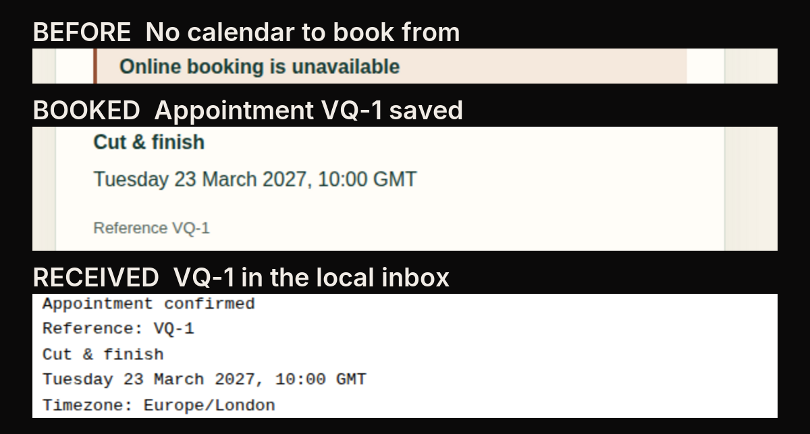
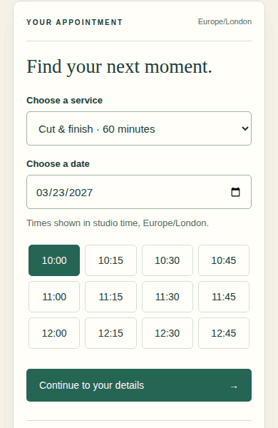

# Customers should book online

<p align="center">
  
</p>

**I completed a booking and received its matching confirmation in the local inbox.**

[Watch the booking finish](#proof) · [Try the booking page and inbox](#try-it-yourself)

<sub>Case 09 of 10 in [WordPress fixes](../README.md)</sub>

## What was wrong

- The appointment page showed an old shortcode instead of available times.
- Two people could reserve the same chair, including the gap between services.
- Summer appointments shifted by an hour, and confirmation messages were missing.

## What I did

- I restored the full journey: choose a service, choose a time, enter details and confirm.
- I made competing reservations share one availability check so only one can take the slot.
- I corrected London time, including both clock changes.
- I checked the received confirmation against the saved appointment and its intended recipient.
- I added opening hours, closed dates and cancellations, with an [owner guide](OWNER-GUIDE.md).

## Proof

**Watch a booking finish: service and time → details → reserved appointment → received email.** The recording starts with the working calendar.

<p align="center"></p>

I received the message in Mailpit, the local inbox shown here. Its reference, service, date and time match the saved booking, and the checks confirm the intended recipient. This proves the booking system sends the right message; delivery to an external inbox still needs checking with the website's mail provider.

[Open the received message](proof/mail-catcher.png) · [Read the message details](proof/confirmation-mail.json) · [See the full before-and-after comparison](media/before-after.png)

| Check | Before | After |
|---|---|---|
| Choose an appointment | [Calendar unavailable](proof/before-acceptance.txt) | [Customer flow works](proof/after-acceptance.txt) |
| Six requests for one slot | [Multiple bookings admitted](proof/before-flow.json) | [One accepted in each of nine races](proof/after-flow.json) |
| Chosen summer time: 10:00 | [Shifted to 11:00](proof/before-flow.json) | [Kept at 10:00](proof/after-flow.json) |
| Confirmation | [No message received](proof/before-flow.json) | [Matching message received locally](proof/confirmation-mail.json) |

I also verified [cancellation and rebooking](proof/after-flow.json), [both clock changes](proof/after-flow.json), and [saved records without overlapping active appointments](proof/persistence.json).

**Files:** [before page](proof/before-desktop.png) · [after page](proof/after-desktop.png) · [before records](proof/before-database.json) · [after records](proof/after-database.json) · [repair](fix/apply.php) · [full log](proof/run-output.txt) · [claim references](proof/claims.json).

## Try it yourself

With Docker Desktop installed, run this command from this folder:

```bash
./try.sh
```

1. Open `http://localhost:8080`, choose a service and an available time, then finish the booking.
2. Open `http://localhost:8025` to read its confirmation. All messages stay in that local inbox, including messages addressed to you.
3. Match the appointment reference on the booking page with the one in the email.

The command leaves the page and inbox open for you. When finished, run `./scripts/stage.sh down` to stop them and remove local booking data. [Setup details and port overrides](REPRODUCE.md) are available if you need them.

## How it is tested

[](https://github.com/Ardholt/wordpress-fixes/actions/workflows/booking-system-setup.yml)

```bash
./run.sh
```

- I run the same customer check against the broken and repaired pages.
- I send competing requests for identical times, neighbouring buffers and overlapping services, then inspect the saved appointments.
- I verify opening hours, closed dates, London clock changes, cancellation, rebooking and matching received mail.
- I exercise the same local start command offered above, complete another booking and find its confirmation.

This command writes fresh proof and removes its containers when finished. [Run conditions and versions](proof/run.json) and [technical reproduction notes](REPRODUCE.md) describe the checks, including the browser-preview limitation.

---

Fixed price in a written scope, sent within hours: see https://ardholt.com/p/prices/.

<sub>Maintained by Genco Doganay, Ardholt · [All 10 cases](../README.md) · [GPL-2.0-or-later](LICENSE)</sub>
