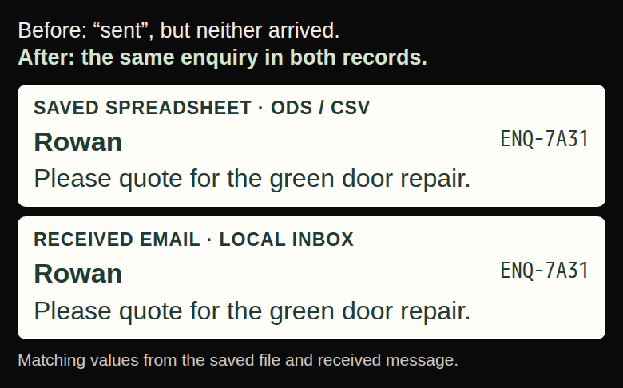
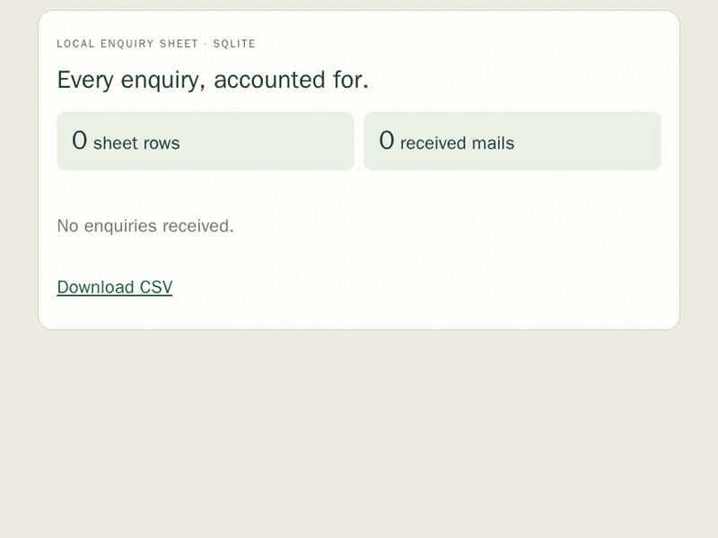

# Form entries should land in a sheet and my inbox

<p align="center">
  
</p>

**I fixed the disappearing enquiry: [the saved spreadsheet and received email contain the same name and message](proof/after.json).**

[See the spreadsheet](proof/06-spreadsheet.png) · [Read the received message](proof/05-mail.png) · [Download the spreadsheet](proof/enquiry.ods)

<sub>Case 07 of 10 in [WordPress fixes](../README.md)</sub>

## What was wrong

- The form said “sent”, but the enquiry never reached either destination.
- There was no saved copy to recover when delivery failed.
- The form was calling an old connection and ignoring the error it received.

## What I did

- I saved each enquiry before attempting delivery, so an interruption would not discard it.
- I made “delivered” mean that both the row and the email had arrived.
- I kept interrupted deliveries for retry and prevented repeated clicks from creating duplicate entries.
- I opened the exported enquiry in LibreOffice Calc and checked its reference, name and message against the received email.

## Proof

**Follow Rowan’s enquiry, ENQ-7A31.** The image above enlarges the values from the verified records. The sequence below shows the form submission, saved row, spreadsheet opened in LibreOffice, and received message.

<p align="center"></p>

| What I checked | Before | After |
|---|---|---|
| Matching saved rows | [0](proof/before.json) | [1](proof/after.json) |
| Matching received emails | [0](proof/before.json) | [1](proof/after.json) |
| Interrupted delivery | [Reported as sent](proof/before.json) | [Saved for retry](proof/mail-outage.json) |

**What this proves:** the WordPress form delivers through a local automated connection to a SQLite-backed sheet and a local email catcher, Mailpit. I also verified the exported spreadsheet in LibreOffice Calc. Delivery to your own spreadsheet account and external mailbox still needs to be connected and verified; these captures do not claim that result.

**Inspect the result:** [spreadsheet file](proof/enquiry.ods) · [CSV file](proof/enquiry.csv) · [spreadsheet capture](proof/06-spreadsheet.png) · [received message](proof/05-mail.png) · [before/after captures](media/before-after.png) · [matching values](proof/after.json)

**Technical evidence:** [spreadsheet check](proof/spreadsheet.json) · [delivery checks](proof/checks.json) · [full run log](proof/run-output.txt) · [claim sources](proof/claims.json) · [before handler](fixtures/broken.php) · [repaired handler](src/delivery.php) · [n8n workflow](workflows/enquiry.json)

## Try it yourself

View the [spreadsheet capture](proof/06-spreadsheet.png) and [received message](proof/05-mail.png) in your browser. You can compare the name and wording without installing anything. The [spreadsheet file](proof/enquiry.ods) also opens in LibreOffice Calc.

<details>
<summary>Reproduce the delivery checks with Docker</summary>

From the case folder, with Docker and Compose installed:

```bash
./run.sh
```

The command checks the broken and repaired flows, refreshes the proof, and removes the containers afterward. [Setup and local addresses](OPERATIONS.md) explain how to leave the form running and inspect it. The [run record](proof/run.json) contains the observed versions and duration.

</details>

## How it is tested

[](https://github.com/Ardholt/wordpress-fixes/actions/workflows/contact-form-to-sheet-and-email.yml)

- I submit through the WordPress page and match the saved row, spreadsheet cells and received message.
- I check invalid input, repeated clicks, conflicting references and unauthorised delivery requests.
- I interrupt both destinations, restart WordPress, then retry the saved enquiries and check that each arrives once.
- I check that spreadsheet-formula text is safely exported. [Results](proof/checks.json) and [recovery evidence](proof/recovered.json) come from the run.

---

Fixed price for this kind of job: £39 (one task automated), see https://ardholt.com/p/prices/.

<sub>Maintained by Genco Doganay, Ardholt · [All 10 cases](../README.md) · [MIT](LICENSE)</sub>
