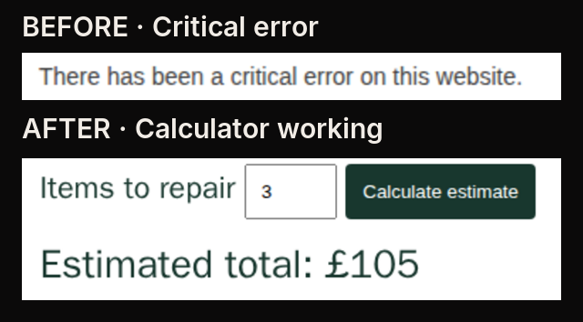

# There has been a critical error on this website

**I fixed the error. The calculator works.**

<p align="center"><a href="media/hero.png"></a></p>

<p align="center"><a href="https://playground.wordpress.net/#ewogICIkc2NoZW1hIjogImh0dHBzOi8vcGxheWdyb3VuZC53b3JkcHJlc3MubmV0L2JsdWVwcmludC1zY2hlbWEuanNvbiIsCiAgInByZWZlcnJlZFZlcnNpb25zIjogewogICAgInBocCI6ICI4LjIiLAogICAgIndwIjogIjYuOCIKICB9LAogICJsYW5kaW5nUGFnZSI6ICIvP2l0ZW1zPTMiLAogICJzdGVwcyI6IFsKICAgIHsKICAgICAgInN0ZXAiOiAibWtkaXIiLAogICAgICAicGF0aCI6ICIvd29yZHByZXNzL3dwLWNvbnRlbnQvbXUtcGx1Z2lucyIKICAgIH0sCiAgICB7CiAgICAgICJzdGVwIjogIndyaXRlRmlsZSIsCiAgICAgICJwYXRoIjogIi93b3JkcHJlc3Mvd3AtY29udGVudC9tdS1wbHVnaW5zL3N0eWxlLnBocCIsCiAgICAgICJkYXRhIjogIjw/cGhwXG4vKiBQbHVnaW4gTmFtZTogRXN0aW1hdGUgUGFnZSBTdHlsZXNcbkxpY2Vuc2U6IEdQTC0yLjAtb3ItbGF0ZXIgKi9cbmFkZF9hY3Rpb24oJ3dwX2hlYWQnLCBmdW5jdGlvbiAoKSB7XG4gZWNobyAnPHN0eWxlPip7Ym94LXNpemluZzpib3JkZXItYm94fWJvZHl7Zm9udC1mYW1pbHk6c3lzdGVtLXVpO2JhY2tncm91bmQ6I2Y1ZjJlYjtjb2xvcjojMTgzNzJlfWhlYWRlcixmb290ZXJ7ZGlzcGxheTpub25lIWltcG9ydGFudH1tYWlue3BhZGRpbmc6MjRweCFpbXBvcnRhbnQ7bWFyZ2luOjAgYXV0byFpbXBvcnRhbnQ7bWF4LXdpZHRoOjEwMDBweDt3aWR0aDoxMDAlfS53cC1zaXRlLWJsb2Nrc3tvdmVyZmxvdy14OmNsaXB9aDF7Zm9udC1zaXplOjM4cHghaW1wb3J0YW50O21hcmdpbjoxMnB4IDAhaW1wb3J0YW50fS5lc3RpbWF0ZXtiYWNrZ3JvdW5kOndoaXRlO2JvcmRlcjoxcHggc29saWQgI2NiZDdkMDtib3JkZXItcmFkaXVzOjEycHg7cGFkZGluZzoyNHB4fS5lc3RpbWF0ZSBoMntmb250LXNpemU6MjhweDttYXJnaW46MCAwIDEwcHh9LmVzdGltYXRlIHB7bWFyZ2luOjEycHggMH1pbnB1dHt3aWR0aDo2NXB4O3BhZGRpbmc6MTBweH1idXR0b257YmFja2dyb3VuZDojMTgzNzJlO2NvbG9yOndoaXRlO3BhZGRpbmc6MTJweDtib3JkZXI6MDtib3JkZXItcmFkaXVzOjRweH0jdG90YWx7Zm9udC13ZWlnaHQ6Ym9sZDtmb250LXNpemU6MjhweH1AbWVkaWEobWF4LXdpZHRoOjUwMHB4KXtoMXtmb250LXNpemU6MjdweCFpbXBvcnRhbnR9LmVzdGltYXRle3BhZGRpbmc6MTZweH1idXR0b257bWFyZ2luLXRvcDoxMHB4fX08L3N0eWxlPic7XG59KTtcbiIKICAgIH0sCiAgICB7CiAgICAgICJzdGVwIjogIm1rZGlyIiwKICAgICAgInBhdGgiOiAiL3dvcmRwcmVzcy93cC1jb250ZW50L3BsdWdpbnMvcmVwYWlyLWVzdGltYXRlIgogICAgfSwKICAgIHsKICAgICAgInN0ZXAiOiAid3JpdGVGaWxlIiwKICAgICAgInBhdGgiOiAiL3dvcmRwcmVzcy93cC1jb250ZW50L3BsdWdpbnMvcmVwYWlyLWVzdGltYXRlL2VzdGltYXRlLnBocCIsCiAgICAgICJkYXRhIjogIjw/cGhwXG4vKiBQbHVnaW4gTmFtZTogUmVwYWlyIEVzdGltYXRlXG5WZXJzaW9uOiAxLjEuMVxuTGljZW5zZTogR1BMLTIuMC1vci1sYXRlclxuKi9cbmZ1bmN0aW9uIHJlcGFpcl9lc3RpbWF0ZV90b3RhbCgkY291bnQpIHtcbiAgICAkY2FsY3VsYXRlID0gc3RhdGljIGZ1bmN0aW9uICgkdW5pdHMpIHsgcmV0dXJuICR1bml0cyAqIDM1OyB9O1xuICAgIHJldHVybiAkY2FsY3VsYXRlKCRjb3VudCk7XG59XG5hZGRfc2hvcnRjb2RlKCdyZXBhaXJfZXN0aW1hdGUnLCBmdW5jdGlvbiAoKSB7XG4gICAgJHJhdyA9IGlzc2V0KCRfR0VUWydpdGVtcyddKSA/IHdwX3Vuc2xhc2goJF9HRVRbJ2l0ZW1zJ10pIDogJzEnO1xuICAgICRjb3VudCA9IGlzX3N0cmluZygkcmF3KSA/IGZpbHRlcl92YXIoJHJhdywgRklMVEVSX1ZBTElEQVRFX0lOVCwgWydvcHRpb25zJyA9PiBbJ21pbl9yYW5nZScgPT4gMSwgJ21heF9yYW5nZScgPT4gMTBdXSkgOiBmYWxzZTtcbiAgICBpZiAoJGNvdW50ID09PSBmYWxzZSkge1xuICAgICAgICByZXR1cm4gJzxwIHJvbGU9XCJhbGVydFwiPkNob29zZSBiZXR3ZWVuIDEgYW5kIDEwIGl0ZW1zLjwvcD4nO1xuICAgIH1cbiAgICAkdG90YWwgPSByZXBhaXJfZXN0aW1hdGVfdG90YWwoJGNvdW50KTtcbiAgICByZXR1cm4gJzxzZWN0aW9uIGNsYXNzPVwiZXN0aW1hdGVcIj48aDI+WW91ciByZXBhaXIgZXN0aW1hdGU8L2gyPjxwPlNtYWxsIGZ1cm5pdHVyZSByZXBhaXJzIFx1MDBiNyBcdTAwYTMzNSBwZXIgaXRlbTwvcD48Zm9ybSBtZXRob2Q9XCJnZXRcIj48bGFiZWwgZm9yPVwiaXRlbXNcIj5JdGVtcyB0byByZXBhaXI8L2xhYmVsPiA8aW5wdXQgaWQ9XCJpdGVtc1wiIG5hbWU9XCJpdGVtc1wiIHR5cGU9XCJudW1iZXJcIiBtaW49XCIxXCIgbWF4PVwiMTBcIiB2YWx1ZT1cIicgLiBlc2NfYXR0cigkY291bnQpIC4gJ1wiPiA8YnV0dG9uIHR5cGU9XCJzdWJtaXRcIj5DYWxjdWxhdGUgZXN0aW1hdGU8L2J1dHRvbj48L2Zvcm0+PHAgaWQ9XCJ0b3RhbFwiIGFyaWEtbGl2ZT1cInBvbGl0ZVwiPkVzdGltYXRlZCB0b3RhbDogXHUwMGEzJyAuIGVzY19odG1sKCR0b3RhbCkgLiAnPC9wPjxwPkZpbmFsIHByaWNlIGFncmVlZCBhZnRlciBpbnNwZWN0aW9uLjwvcD48L3NlY3Rpb24+Jztcbn0pO1xuIgogICAgfSwKICAgIHsKICAgICAgInN0ZXAiOiAiYWN0aXZhdGVQbHVnaW4iLAogICAgICAicGx1Z2luUGF0aCI6ICJyZXBhaXItZXN0aW1hdGUvZXN0aW1hdGUucGhwIgogICAgfSwKICAgIHsKICAgICAgInN0ZXAiOiAicnVuUEhQIiwKICAgICAgImNvZGUiOiAiPD9waHAgcmVxdWlyZSAnL3dvcmRwcmVzcy93cC1sb2FkLnBocCc7IFxuJGhvbWUgPSB3cF9pbnNlcnRfcG9zdChbJ3Bvc3RfdGl0bGUnPT4nRnVybml0dXJlIHJlcGFpciBlc3RpbWF0ZXMnLCAncG9zdF9jb250ZW50Jz0+J1tyZXBhaXJfZXN0aW1hdGVdJywgJ3Bvc3Rfc3RhdHVzJz0+J3B1Ymxpc2gnLCAncG9zdF90eXBlJz0+J3BhZ2UnXSk7XG51cGRhdGVfb3B0aW9uKCdzaG93X29uX2Zyb250JywgJ3BhZ2UnKTtcbnVwZGF0ZV9vcHRpb24oJ3BhZ2Vfb25fZnJvbnQnLCAkaG9tZSk7XG53cF9pbnNlcnRfcG9zdChbJ3Bvc3RfdGl0bGUnPT4nQWJvdXQgdGhlIHdvcmtzaG9wJywgJ3Bvc3RfbmFtZSc9PidhYm91dCcsICdwb3N0X2NvbnRlbnQnPT4nRnVybml0dXJlIHJlcGFpcnMgd2l0aCBhIGNsZWFyIGVzdGltYXRlIGJlZm9yZSB3b3JrIGJlZ2lucy4nLCAncG9zdF9zdGF0dXMnPT4ncHVibGlzaCcsICdwb3N0X3R5cGUnPT4ncGFnZSddKTtcblxudXBkYXRlX29wdGlvbignYmxvZ25hbWUnLCAnRnVybml0dXJlIHJlcGFpciBlc3RpbWF0ZXMnKTsgd3BfZGVsZXRlX3Bvc3QoMSwgdHJ1ZSk7IHdwX2RlbGV0ZV9wb3N0KDIsIHRydWUpOyIKICAgIH0KICBdLAogICJsb2dpbiI6IGZhbHNlCn0K"></a></p>

## What was wrong

- After the plugin update, the estimate page showed the critical-error message above.
- The repair calculator could no longer give visitors a price.
- I traced the failure to an outdated instruction in the updated plugin.

## What I did

- I matched the error record to the exact line that stopped the page loading.
- I restored the saved plugin and checked that estimates worked again.
- I corrected the update so the calculator could keep running.
- I submitted new estimates and checked the rest of the page after the repair.

## Proof

**The calculator works, including when the quantity changes.** I checked [three items at £105 and two items at £70](proof/fixed.json) by submitting the form. You can try it with the button above.

**The cause is recorded.** The [original error log](proof/php-error-before.log) names the failed instruction and the plugin line. The [error log after repair](proof/php-error-after.log) is empty following the checks.

**Recovery from the backup works too.** I restored the saved plugin, then [checked the calculator again](proof/rollback.json) before applying the corrected update.

[Full before-and-after image](media/hero.png) · [Before page](proof/broken.png) · [Working page](proof/fixed.png) · [Phone view](proof/fixed-mobile.png)

[Before code](fixtures/estimate-1.1.0.php) · [Corrected code](fix/estimate-1.1.1.php) · [Exact change](fix/update.patch) · [Complete check results](proof/run-output.txt)

## Try it yourself

Open **Try the repair calculator** above, change the number of items, then choose **Calculate estimate**. I verified that interaction in a browser: [record](proof/demo.json) and [screen capture](proof/playground.png).

<details>
<summary>Run the failure and recovery yourself — technical instructions</summary>

With Docker and Compose installed:

```bash
cd critical-error-after-update
./run.sh
```

This runs the broken update, verifies recovery from the backup, and checks the corrected update. It saves screenshots and results, then removes the local installation. See the [recovery guide](RECOVERY.md) for the code's scope, backup commands, individual stages, port settings and dependencies. [Recorded runtime and conditions](proof/run.json).

</details>

## How it is tested

[](https://github.com/Ardholt/wordpress-fixes/actions/workflows/critical-error-after-update.yml)

- The page check [fails with the broken update](proof/healthy-check-broken.txt) and [passes after repair](proof/healthy-check-fixed.txt).
- Browser checks submit estimates after both backup recovery and the permanent repair, reject invalid quantities, and check the phone layout.
- The separate About page must still load. Recovered pages must leave an empty error log during the checks.

[Behavioral tests](tests/check.cjs) · [Workflow source](https://github.com/Ardholt/wordpress-fixes/blob/main/.github/workflows/critical-error-after-update.yml) · [Evidence for the claims](proof/claims.json)

---

Fixed price for this kind of job: £10 (WordPress fix, £10 a fault, 1 working day), see https://ardholt.com/p/prices/.

<sub>Maintained by Genco Doganay, Ardholt · [All cases](../README.md)</sub>
