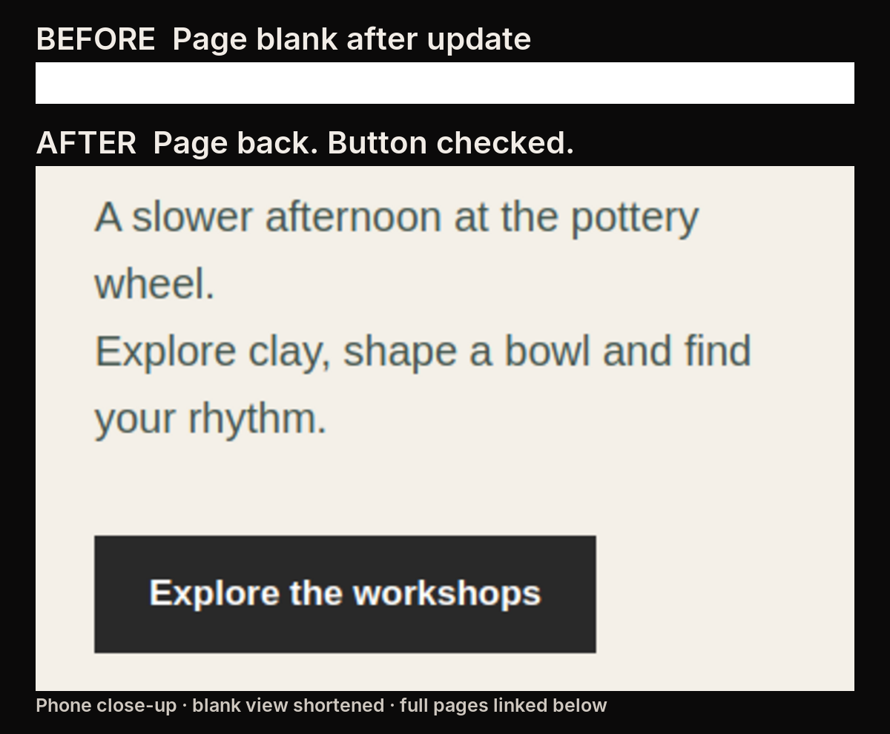

# Pages broke after an Elementor update

  

**I brought the workshop page back and checked that its button opens the details.**

  <a href="https://playground.wordpress.net/#ewogICIkc2NoZW1hIjogImh0dHBzOi8vcGxheWdyb3VuZC53b3JkcHJlc3MubmV0L2JsdWVwcmludC1zY2hlbWEuanNvbiIsCiAgInByZWZlcnJlZFZlcnNpb25zIjogewogICAgInBocCI6ICI4LjIiLAogICAgIndwIjogIjYuNyIKICB9LAogICJmZWF0dXJlcyI6IHsKICAgICJuZXR3b3JraW5nIjogdHJ1ZQogIH0sCiAgImxhbmRpbmdQYWdlIjogIi8/cGFnZW5hbWU9d29ya3Nob3BzIiwKICAic3RlcHMiOiBbCiAgICB7CiAgICAgICJzdGVwIjogImluc3RhbGxUaGVtZSIsCiAgICAgICJ0aGVtZURhdGEiOiB7CiAgICAgICAgInJlc291cmNlIjogInVybCIsCiAgICAgICAgInVybCI6ICJodHRwczovL2Rvd25sb2Fkcy53b3JkcHJlc3Mub3JnL3RoZW1lL3BobG94LjIuMTYuNy56aXAiCiAgICAgIH0sCiAgICAgICJvcHRpb25zIjogewogICAgICAgICJhY3RpdmF0ZSI6IHRydWUKICAgICAgfQogICAgfSwKICAgIHsKICAgICAgInN0ZXAiOiAiaW5zdGFsbFBsdWdpbiIsCiAgICAgICJwbHVnaW5EYXRhIjogewogICAgICAgICJyZXNvdXJjZSI6ICJ1cmwiLAogICAgICAgICJ1cmwiOiAiaHR0cHM6Ly9kb3dubG9hZHMud29yZHByZXNzLm9yZy9wbHVnaW4vZWxlbWVudG9yLjMuMjYuMC56aXAiCiAgICAgIH0sCiAgICAgICJvcHRpb25zIjogewogICAgICAgICJhY3RpdmF0ZSI6IHRydWUKICAgICAgfQogICAgfSwKICAgIHsKICAgICAgInN0ZXAiOiAiaW5zdGFsbFBsdWdpbiIsCiAgICAgICJwbHVnaW5EYXRhIjogewogICAgICAgICJyZXNvdXJjZSI6ICJ1cmwiLAogICAgICAgICJ1cmwiOiAiaHR0cHM6Ly9kb3dubG9hZHMud29yZHByZXNzLm9yZy9wbHVnaW4vYXV4aW4tZWxlbWVudHMuMi4xNy4wLnppcCIKICAgICAgfSwKICAgICAgIm9wdGlvbnMiOiB7CiAgICAgICAgImFjdGl2YXRlIjogdHJ1ZQogICAgICB9CiAgICB9LAogICAgewogICAgICAic3RlcCI6ICJ3cml0ZUZpbGUiLAogICAgICAicGF0aCI6ICIvd29yZHByZXNzL3dwLWNvbnRlbnQvbXUtcGx1Z2lucy93b3Jrc2hvcC1zdHlsZS5waHAiLAogICAgICAiZGF0YSI6ICI8P3BocFxuLy8gTG9jYWwgcHJlc2VudGF0aW9uIHNoYXJlZCBieSB0aGUgb3JpZ2luYWwgYW5kIHJlcGFpcmVkIEVsZW1lbnRvciBkb2N1bWVudHMuXG5hZGRfZmlsdGVyKCdlbGVtZW50b3IvZnJvbnRlbmQvcHJpbnRfZ29vZ2xlX2ZvbnRzJywgJ19fcmV0dXJuX2ZhbHNlJyk7XG5hZGRfYWN0aW9uKCd3cF9oZWFkJywgZnVuY3Rpb24gKCkgeyA/PlxuPHN0eWxlPlxuYm9keSB7IG1hcmdpbjowOyBiYWNrZ3JvdW5kOiNmNGYwZTg7IGNvbG9yOiMyNjNjMzY7IGZvbnQtZmFtaWx5OkFyaWFsLHNhbnMtc2VyaWY7IH1cbi5lbGVtZW50b3IgeyBtYXgtd2lkdGg6MTE2MHB4OyBtYXJnaW46YXV0bzsgcGFkZGluZzo0OHB4IDM2cHg7IH1cbi5lbGVtZW50b3IgLmVsZW1lbnRvci1oZWFkaW5nLXRpdGxlIHsgY29sb3I6IzI2M2MzNjsgZm9udC1mYW1pbHk6R2VvcmdpYSxzZXJpZjsgZm9udC13ZWlnaHQ6NDAwOyB9XG4uZWxlbWVudG9yIGgxLmVsZW1lbnRvci1oZWFkaW5nLXRpdGxlIHsgZm9udC1zaXplOjYycHg7IGxpbmUtaGVpZ2h0OjEuMDY7IH1cbi5lbGVtZW50b3IgaDIuZWxlbWVudG9yLWhlYWRpbmctdGl0bGUgeyBmb250LXNpemU6MzFweDsgbGluZS1oZWlnaHQ6MS4yOyB9XG4uZWxlbWVudG9yIC5lbGVtZW50b3Itd2lkZ2V0LXRleHQtZWRpdG9yIHsgZm9udDoyMHB4LzEuNiBBcmlhbCxzYW5zLXNlcmlmOyBjb2xvcjojNDI1NDRkOyB9XG4uZWxlbWVudG9yIC5hdXgtbW9kZXJuLWJ1dHRvbiB7IGJhY2tncm91bmQ6IzI2M2MzNjsgYm9yZGVyLXJhZGl1czo0cHg7IHBhZGRpbmc6MThweCAyNnB4OyB9XG4uZWxlbWVudG9yIC5hdXgtbW9kZXJuLWJ1dHRvbiAuYXV4LXRleHQgeyBjb2xvcjojZmZmOyBmb250OjYwMCAxN3B4IEFyaWFsLHNhbnMtc2VyaWY7IH1cbi5lbGVtZW50b3IgLmVsZW1lbnRvci13aWRnZXQtY29udGFpbmVyIHsgbWFyZ2luLWJvdHRvbToxOHB4OyB9XG4uZWxlbWVudG9yIC53b3Jrc2hvcC1jYXJkIHsgYmFja2dyb3VuZDojZTFlN2RjOyBwYWRkaW5nOjMwcHg7IGJvcmRlci1yYWRpdXM6NHB4OyB9XG4uZWxlbWVudG9yIC5leWVicm93IHsgZm9udDo2MDAgMTNweCBBcmlhbCxzYW5zLXNlcmlmOyBsZXR0ZXItc3BhY2luZzozcHg7IH1cbkBtZWRpYShtYXgtd2lkdGg6NzY3cHgpIHsgLmVsZW1lbnRvciB7IHBhZGRpbmc6MjhweCAxOHB4OyB9IC5lbGVtZW50b3IgaDEuZWxlbWVudG9yLWhlYWRpbmctdGl0bGUgeyBmb250LXNpemU6NDJweDsgfSAuZWxlbWVudG9yIC53b3Jrc2hvcC1jYXJkIHsgbWFyZ2luLXRvcDoyMnB4OyB9IH1cbjwvc3R5bGU+XG48P3BocCB9KTtcbiIKICAgIH0sCiAgICB7CiAgICAgICJzdGVwIjogInJ1blBIUCIsCiAgICAgICJjb2RlIjogIjw/cGhwXG5yZXF1aXJlIFwiL3dvcmRwcmVzcy93cC1sb2FkLnBocFwiO1xuLy8gVHdvIHNtYWxsLCBlZGl0YWJsZSBFbGVtZW50b3IgZG9jdW1lbnRzOyBubyBpbXBvcnRlZCBzaXRlIGNvbnRlbnQgb3IgbWVkaWEuXG51cGRhdGVfb3B0aW9uKCdlbGVtZW50b3JfZGlzYWJsZV9jb2xvcl9zY2hlbWVzJywgJ3llcycpO1xudXBkYXRlX29wdGlvbignZWxlbWVudG9yX2Rpc2FibGVfdHlwb2dyYXBoeV9zY2hlbWVzJywgJ3llcycpO1xudXBkYXRlX29wdGlvbignZWxlbWVudG9yX2V4cGVyaW1lbnQtY29udGFpbmVyJywgJ2luYWN0aXZlJyk7XG51cGRhdGVfb3B0aW9uKCdlbGVtZW50b3JfZXhwZXJpbWVudC1lX29wdGltaXplZF9tYXJrdXAnLCAnaW5hY3RpdmUnKTtcbnVwZGF0ZV9vcHRpb24oJ2VsZW1lbnRvcl9leHBlcmltZW50LWVfZWxlbWVudF9jYWNoZScsICdpbmFjdGl2ZScpO1xuLy8gR2VuZXJhdGUgUGhsb3gncyBub3JtYWwgdGhlbWUgYXNzZXRzIG9uIGEgZnJlc2ggaW5zdGFsbC5cbmF1eGluX3NhdmVfY3VzdG9tX2NzcygpO1xuYXV4aW5fc2F2ZV9jdXN0b21fanMoKTtcbiRjb3VudGVyID0gMDtcbiR3aWRnZXQgPSBmdW5jdGlvbiAoJG5hbWUsICRzZXR0aW5ncykgdXNlICgmJGNvdW50ZXIpIHtcbiAgICByZXR1cm4gWydpZCc9PnNwcmludGYoJyUwN3gnLCArKyRjb3VudGVyKSwgJ2VsVHlwZSc9Pid3aWRnZXQnLCAnd2lkZ2V0VHlwZSc9PiRuYW1lLCAnc2V0dGluZ3MnPT4kc2V0dGluZ3MsICdlbGVtZW50cyc9PltdXTtcbn07XG4kY29sdW1uID0gZnVuY3Rpb24gKCR3aWR0aCwgJGNoaWxkcmVuLCAkZXh0cmE9W10pIHVzZSAoJiRjb3VudGVyKSB7XG4gICAgcmV0dXJuIFsnaWQnPT5zcHJpbnRmKCclMDd4JywgKyskY291bnRlciksICdlbFR5cGUnPT4nY29sdW1uJywgJ3NldHRpbmdzJz0+YXJyYXlfbWVyZ2UoWydfY29sdW1uX3NpemUnPT4kd2lkdGhdLCAkZXh0cmEpLCAnZWxlbWVudHMnPT4kY2hpbGRyZW5dO1xufTtcbiRzZWN0aW9uID0gZnVuY3Rpb24gKCRjb2x1bW5zKSB1c2UgKCYkY291bnRlcikge1xuICAgIHJldHVybiBbJ2lkJz0+c3ByaW50ZignJTA3eCcsICsrJGNvdW50ZXIpLCAnZWxUeXBlJz0+J3NlY3Rpb24nLCAnc2V0dGluZ3MnPT5bJ2NvbnRlbnRfd2lkdGgnPT5bJ3VuaXQnPT4ncHgnLCdzaXplJz0+MTA4MF1dLCAnZWxlbWVudHMnPT4kY29sdW1uc107XG59O1xuJGNyZWF0ZSA9IGZ1bmN0aW9uICgkdGl0bGUsICRzbHVnLCAkZGF0YSkge1xuICAgICRpZD13cF9pbnNlcnRfcG9zdChbJ3Bvc3RfdHlwZSc9PidwYWdlJywncG9zdF9zdGF0dXMnPT4ncHVibGlzaCcsJ3Bvc3RfdGl0bGUnPT4kdGl0bGUsJ3Bvc3RfbmFtZSc9PiRzbHVnXSk7XG4gICAgdXBkYXRlX3Bvc3RfbWV0YSgkaWQsICdfd3BfcGFnZV90ZW1wbGF0ZScsICdlbGVtZW50b3JfY2FudmFzJyk7XG4gICAgdXBkYXRlX3Bvc3RfbWV0YSgkaWQsICdfZWxlbWVudG9yX2VkaXRfbW9kZScsICdidWlsZGVyJyk7XG4gICAgdXBkYXRlX3Bvc3RfbWV0YSgkaWQsICdfZWxlbWVudG9yX3RlbXBsYXRlX3R5cGUnLCAnd3AtcGFnZScpO1xuICAgIHVwZGF0ZV9wb3N0X21ldGEoJGlkLCAnX2VsZW1lbnRvcl92ZXJzaW9uJywgRUxFTUVOVE9SX1ZFUlNJT04pO1xuICAgIHVwZGF0ZV9wb3N0X21ldGEoJGlkLCAnX2VsZW1lbnRvcl9kYXRhJywgd3Bfc2xhc2god3BfanNvbl9lbmNvZGUoJGRhdGEpKSk7XG4gICAgcmV0dXJuICRpZDtcbn07XG4kaG9tZT0kY3JlYXRlKCdDbGF5IHdvcmtzaG9wcycsICd3b3Jrc2hvcHMnLCBbJHNlY3Rpb24oW1xuICAgICRjb2x1bW4oNjAsIFtcbiAgICAgICAgJHdpZGdldCgndGV4dC1lZGl0b3InLCBbJ2VkaXRvcic9Pic8cCBjbGFzcz1cImV5ZWJyb3dcIj5DTEFZIC8gV09SS1NIT1BTPC9wPiddKSxcbiAgICAgICAgJHdpZGdldCgnaGVhZGluZycsIFsndGl0bGUnPT4nTWFrZSBzb21ldGhpbmc8YnI+d2l0aCB5b3VyIGhhbmRzLicsICdoZWFkZXJfc2l6ZSc9PidoMSddKSxcbiAgICAgICAgJHdpZGdldCgndGV4dC1lZGl0b3InLCBbJ2VkaXRvcic9Pic8cD5BIHNsb3dlciBhZnRlcm5vb24gYXQgdGhlIHBvdHRlcnkgd2hlZWwuPGJyPkV4cGxvcmUgY2xheSwgc2hhcGUgYSBib3dsIGFuZCBmaW5kIHlvdXIgcmh5dGhtLjwvcD4nXSksXG4gICAgICAgICR3aWRnZXQoJ2F1eF9tb2Rlcm5fYnV0dG9uJywgWydsYWJlbCc9PidFeHBsb3JlIHRoZSB3b3Jrc2hvcHMnLCAnbGluayc9PlsndXJsJz0+Jy8/cGFnZW5hbWU9ZGV0YWlscyddLCAnYnRuX3NpemUnPT4nbGFyZ2UnLCAnYnRuX2FsaWduJz0+J2xlZnQnLCAndGV4dF9ub3JtYWxfdHlwb190eXBvZ3JhcGh5Jz0+J2N1c3RvbScsICd0ZXh0X25vcm1hbF90eXBvX2ZvbnRfZmFtaWx5Jz0+J0FyaWFsJ10pXG4gICAgXSksXG4gICAgJGNvbHVtbig0MCwgW1xuICAgICAgICAkd2lkZ2V0KCdoZWFkaW5nJywgWyd0aXRsZSc9PidZb3VyIGFmdGVybm9vbiBpbiBjbGF5JywgJ2hlYWRlcl9zaXplJz0+J2gyJ10pLFxuICAgICAgICAkd2lkZ2V0KCd0ZXh0LWVkaXRvcicsIFsnZWRpdG9yJz0+JzxwPjxzdHJvbmc+U2V0dGxlIGluPC9zdHJvbmc+PGJyPk1lZXQgdGhlIGNsYXkgYW5kIGxlYXJuIHRoZSB3aGVlbC48L3A+PHA+PHN0cm9uZz5GaW5kIHlvdXIgc2hhcGU8L3N0cm9uZz48YnI+QnVpbGQgY29uZmlkZW5jZSB3aXRoIGhhbmRzLW9uIGd1aWRhbmNlLjwvcD48cD48c3Ryb25nPk1ha2UgaXQgeW91cnM8L3N0cm9uZz48YnI+Q2hvb3NlIGEgZ2xhemUgZm9yIHlvdXIgZmluaXNoZWQgcGllY2UuPC9wPiddKVxuICAgIF0sIFsnY3NzX2NsYXNzZXMnPT4nd29ya3Nob3AtY2FyZCddKVxuXSldKTtcbiRjcmVhdGUoJ1dvcmtzaG9wIGRldGFpbHMnLCAnZGV0YWlscycsIFskc2VjdGlvbihbJGNvbHVtbigxMDAsIFtcbiAgICAkd2lkZ2V0KCdoZWFkaW5nJywgWyd0aXRsZSc9PidBIGxpdHRsZSBzcGFjZSB0byBtYWtlLicsICdoZWFkZXJfc2l6ZSc9PidoMSddKSxcbiAgICAkd2lkZ2V0KCd0ZXh0LWVkaXRvcicsIFsnZWRpdG9yJz0+JzxwPkNsYXksIHRvb2xzIGFuZCBhbiBhcHJvbiBhcmUgcmVhZHkgYXQgdGhlIHdoZWVsLiBXZWFyIGNvbWZvcnRhYmxlIGNsb3RoZXMgYW5kIGNvbWUgcmVhZHkgdG8gdHJ5IHNvbWV0aGluZyBuZXcuPC9wPiddKSxcbiAgICAkd2lkZ2V0KCdidXR0b24nLCBbJ3RleHQnPT4nQmFjayB0byB3b3Jrc2hvcHMnLCAnbGluayc9PlsndXJsJz0+Jy8/cGFnZW5hbWU9d29ya3Nob3BzJ11dKVxuXSldKV0pO1xudXBkYXRlX29wdGlvbignc2hvd19vbl9mcm9udCcsICdwYWdlJyk7XG51cGRhdGVfb3B0aW9uKCdwYWdlX29uX2Zyb250JywgJGhvbWUpO1xuZWNobyBcIkNyZWF0ZWQgd29ya3Nob3AgYW5kIGRldGFpbHMgcGFnZXMuXFxuXCI7XG4iCiAgICB9CiAgXQp9Cg=="></a>

Case 01 of 10 in [WordPress fixes](../README.md)

## What was wrong

- Updating Elementor left the workshop page blank.
- Visitors could no longer read the workshop details or follow its button.
- The older Phlox add-on called a typography class that the Elementor update removed.

## What I did

- I reproduced the update failure on the workshop page shown here, starting with a capture of its working appearance.
- I traced the failure to the Phlox button, keeping a separate page as a control.
- I updated **Phlox Core Elements from 2.16.4 to 2.17.0**, keeping Elementor active at 3.26.0.
- I regenerated Elementor’s page styles, checked the saved content and appearance, and clicked the workshop button to confirm it opened the details.

## Proof

I restored the page shown here and followed its “Explore the workshops” button to the details page. [See the page reached by that click](proof/fixed-button-destination-390.png), or open the working page above and try it yourself.

The screenshots and checks come from my reproduction of this update failure. They are not a record of a customer commission.

| Check | Before repair | After repair |
|---|---|---|
| Workshop page | [Blank](proof/broken.json) | [Restored](proof/fixed.json) |
| PHP log | [Fatal error](proof/broken-php.log) | [Clear](proof/fixed-php.log) |
| Details page | [Works](proof/broken.json) | [Works](proof/fixed.json) |
| Saved content | [Original](proof/baseline-content.json) | [Unchanged](proof/fixed-content.json) |
| Appearance | [Before update](proof/baseline-workshops-390.png) | [Matches](proof/comparison.json) |

I compared the repaired page with its working appearance **before the update**, not with the blank screen. All four screenshot pairs matched exactly; the [pixel comparison](proof/comparison.json) records the measurements.

[Log counts](proof/log-checks.json) accompany the actual PHP logs; the empty after-log contains no PHP messages from the repaired page checks.

The broken page still returned HTTP 200. I checked what visitors could actually see and use, alongside the PHP log.

**Cause:** Phlox’s button referenced `Elementor\Core\Schemes\Typography`; its compatible release uses `Global_Typography`. [Vendor code change](proof/vendor-change.diff) · [Repair command](fix/apply.sh).

**Files:** [broken page PNG](proof/broken-workshops-1280.png) · [repaired page PNG](proof/fixed-workshops-1280.png) · [original page PNG](proof/baseline-workshops-1280.png) · [mobile before](proof/broken-workshops-390.png) · [mobile after](proof/fixed-workshops-390.png) · [full run log](proof/run-output.txt).

[Run conditions and versions](proof/run.json) · [Claim sources](proof/claims.json) · [Playground verification](proof/demo.json).

## Try it yourself

Open the working page using the button above. Choose **Explore the workshops** to reach the workshop details. No installation is needed.

For the full update-and-repair procedure, see the [technical run guide](RUNBOOK.md).

## How it is tested

[Automated checks and run history](https://github.com/Ardholt/wordpress-fixes/actions/workflows/elementor-update-broke-pages.yml) · [Recorded passing run](proof/run-output.txt)

- I run the same browser checks before the update, after it breaks, and after the repair. The broken state must fail them with the specific PHP error.
- I check the actual Elementor page, Phlox button navigation, readable content and responsive layout at desktop and phone widths. The separate details page must stay healthy throughout.
- I check that the saved content and the appearance from before the update are retained. The [technical run guide](RUNBOOK.md) explains the comparison method and tolerance.

---

Fixed price for this kind of job: £10 (WordPress fix, £10 a fault, 1 working day), see https://ardholt.com/p/prices/.

Maintained by Genco Doganay, Ardholt · [All 10 cases](../README.md) · [Licence](../LICENSE)
