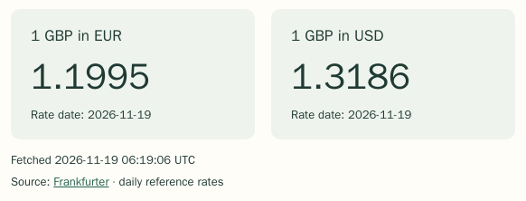
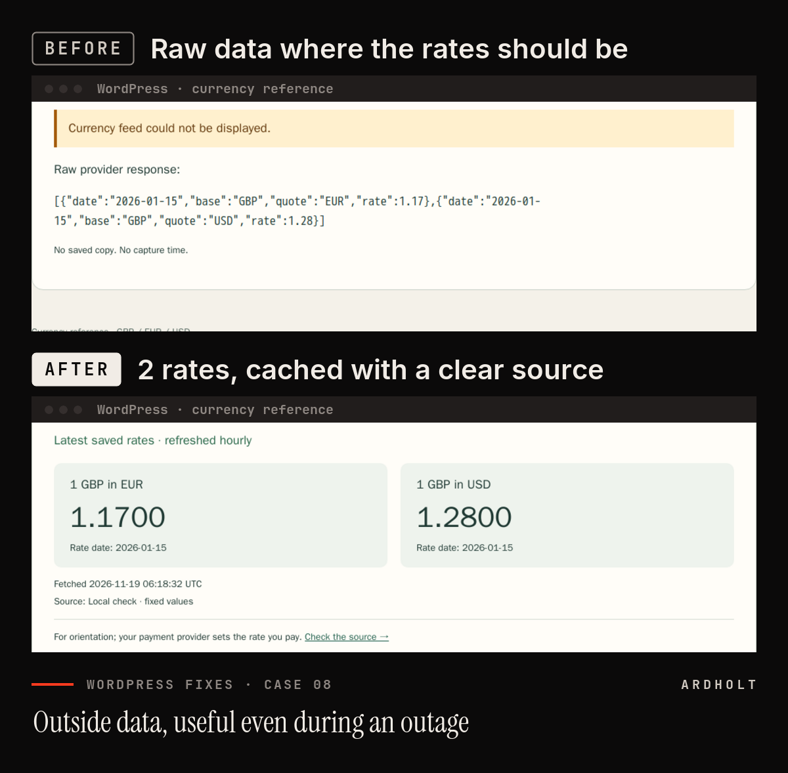

# Show outside data on my site

I received these real rates from Frankfurter on **19 Nov 2026 at 06:19 UTC**.

  

  <a href="https://playground.wordpress.net/#%7B%22%24schema%22%3A%22https%3A%2F%2Fplayground.wordpress.net%2Fblueprint-schema.json%22%2C%22preferredVersions%22%3A%7B%22php%22%3A%228.3%22%2C%22wp%22%3A%226.8%22%7D%2C%22features%22%3A%7B%22networking%22%3Atrue%7D%2C%22landingPage%22%3A%22%2F%22%2C%22steps%22%3A%5B%7B%22step%22%3A%22mkdir%22%2C%22path%22%3A%22%2Fwordpress%2Fwp-content%2Fmu-plugins%22%7D%2C%7B%22step%22%3A%22writeFile%22%2C%22path%22%3A%22%2Fwordpress%2Fwp-content%2Fmu-plugins%2Frates.php%22%2C%22data%22%3A%22%3C%3Fphp%5Cn%2F**%5Cn%20*%20Plugin%20Name%3A%20Reference%20Rates%5Cn%20*%20Description%3A%20Validated%20Frankfurter%20rates%20with%20a%20last-good%20cache%20and%20clear%20outage%20states.%5Cn%20*%20Version%3A%201.0.0%5Cn%20*%20License%3A%20MIT%5Cn%20*%2F%5Cnif%20(!defined('ABSPATH'))%20%7B%20exit%3B%20%7D%5Cnfunction%20rr_endpoint()%20%7B%5Cn%20%20%20%20return%20defined('RR_FIXTURE')%20%26%26%20RR_FIXTURE%20%3F%20'http%3A%2F%2Ffixture%3A8000%2Frates'%20%3A%20'https%3A%2F%2Fapi.frankfurter.dev%2Fv2%2Frates%3Fbase%3DGBP%26quotes%3DEUR%2CUSD'%3B%5Cn%7D%5Cnfunction%20rr_valid(%24rows)%20%7B%5Cn%20%20%20%20if%20(!is_array(%24rows)%20%7C%7C%20count(%24rows)%20!%3D%3D%202)%20%7B%20return%20false%3B%20%7D%5Cn%20%20%20%20%24out%20%3D%20%5B%5D%3B%5Cn%20%20%20%20foreach%20(%24rows%20as%20%24row)%20%7B%5Cn%20%20%20%20%20%20%20%20if%20(!is_array(%24row)%20%7C%7C%20(%24row%5B'base'%5D%20%3F%3F%20'')%20!%3D%3D%20'GBP'%20%7C%7C%20!in_array(%24row%5B'quote'%5D%20%3F%3F%20''%2C%20%5B'EUR'%2C'USD'%5D%2C%20true))%20%7B%20return%20false%3B%20%7D%5Cn%20%20%20%20%20%20%20%20%24date%20%3D%20%24row%5B'date'%5D%20%3F%3F%20''%3B%5Cn%20%20%20%20%20%20%20%20if%20(!is_string(%24date)%20%7C%7C%20!preg_match('%2F%5E%5C%5Cd%7B4%7D-%5C%5Cd%7B2%7D-%5C%5Cd%7B2%7D%24%2FD'%2C%20%24date))%20%7B%20return%20false%3B%20%7D%5Cn%20%20%20%20%20%20%20%20%5B%24y%2C%24m%2C%24d%5D%20%3D%20array_map('intval'%2C%20explode('-'%2C%20%24date))%3B%5Cn%20%20%20%20%20%20%20%20%24rate%20%3D%20%24row%5B'rate'%5D%20%3F%3F%20null%3B%5Cn%20%20%20%20%20%20%20%20if%20(!checkdate(%24m%2C%24d%2C%24y)%20%7C%7C%20%24date%20%3E%20gmdate('Y-m-d')%20%7C%7C%20(!is_int(%24rate)%20%26%26%20!is_float(%24rate))%20%7C%7C%20!is_finite((float)%24rate)%20%7C%7C%20%24rate%20%3C%3D%200%20%7C%7C%20%24rate%20%3E%201000%20%7C%7C%20isset(%24out%5B%24row%5B'quote'%5D%5D))%20%7B%20return%20false%3B%20%7D%5Cn%20%20%20%20%20%20%20%20%24out%5B%24row%5B'quote'%5D%5D%20%3D%20%5B'rate'%20%3D%3E%20%24rate%2C%20'date'%20%3D%3E%20%24date%5D%3B%5Cn%20%20%20%20%7D%5Cn%20%20%20%20return%20%24out%3B%5Cn%7D%5Cnfunction%20rr_unlock(%24owner)%20%7B%5Cn%20%20%20%20global%20%24wpdb%3B%5Cn%20%20%20%20%2F%2F%20Compare-and-delete%3A%20a%20delayed%20worker%20cannot%20remove%20a%20newer%20visitor's%20lock.%5Cn%20%20%20%20%24removed%20%3D%20%24wpdb-%3Equery(%24wpdb-%3Eprepare(%5C%22DELETE%20FROM%20%7B%24wpdb-%3Eoptions%7D%20WHERE%20option_name%20%3D%20%25s%20AND%20option_value%20%3D%20%25s%5C%22%2C%20'rr_lock'%2C%20(string)%24owner))%3B%5Cn%20%20%20%20wp_cache_delete('rr_lock'%2C%20'options')%3B%5Cn%20%20%20%20return%20%24removed%3B%5Cn%7D%5Cnfunction%20rr_data()%20%7B%5Cn%20%20%20%20%24now%20%3D%20time()%3B%5Cn%20%20%20%20%24cache%20%3D%20get_option('rr_cache'%2C%20%5B%5D)%3B%5Cn%20%20%20%20%2F%2F%20Keep%20last-good%20data%20separately%20from%20the%20refresh%20timer%3B%20failures%20cannot%20overwrite%20it.%5Cn%20%20%20%20if%20((%24cache%5B'source'%5D%20%3F%3F%20'')%20!%3D%3D%20rr_endpoint())%20%7B%20%24cache%20%3D%20%5B%5D%3B%20%7D%5Cn%20%20%20%20if%20(%24cache%20%26%26%20%24now%20-%20%24cache%5B'captured'%5D%20%3C%203600)%20%7B%20return%20%5B%24cache%2C%20'fresh'%5D%3B%20%7D%5Cn%20%20%20%20if%20(!get_transient('rr_backoff'))%20%7B%5Cn%20%20%20%20%20%20%20%20%2F%2F%20Atomic%20option%20insertion%20prevents%20concurrent%20visitors%20from%20starting%20the%20same%20refresh.%5Cn%20%20%20%20%20%20%20%20%24locked%20%3D%20add_option('rr_lock'%2C%20%24now%2C%20''%2C%20false)%3B%5Cn%20%20%20%20%20%20%20%20if%20(!%24locked)%20%7B%5Cn%20%20%20%20%20%20%20%20%20%20%20%20%24owner%20%3D%20(int)get_option('rr_lock')%3B%5Cn%20%20%20%20%20%20%20%20%20%20%20%20if%20(%24owner%20%3C%20%24now%20-%2015%20%26%26%20rr_unlock(%24owner))%20%7B%20%24locked%20%3D%20add_option('rr_lock'%2C%20%24now%2C%20''%2C%20false)%3B%20%7D%5Cn%20%20%20%20%20%20%20%20%7D%5Cn%20%20%20%20%20%20%20%20if%20(%24locked)%20%7B%5Cn%20%20%20%20%20%20%20%20%20%20%20%20set_transient('rr_backoff'%2C%201%2C%2060)%3B%5Cn%20%20%20%20%20%20%20%20%20%20%20%20%24response%20%3D%20wp_remote_get(rr_endpoint()%2C%20%5B'timeout'%3D%3E2%2C%20'redirection'%3D%3E0%2C%20'limit_response_size'%3D%3E8192%5D)%3B%5Cn%20%20%20%20%20%20%20%20%20%20%20%20%24rows%20%3D%20!is_wp_error(%24response)%20%26%26%20wp_remote_retrieve_response_code(%24response)%20%3D%3D%3D%20200%20%3F%20rr_valid(json_decode(wp_remote_retrieve_body(%24response)%2C%20true))%20%3A%20false%3B%5Cn%20%20%20%20%20%20%20%20%20%20%20%20if%20(%24rows)%20%7B%5Cn%20%20%20%20%20%20%20%20%20%20%20%20%20%20%20%20%24cache%20%3D%20%5B'rows'%3D%3E%24rows%2C%20'captured'%3D%3E%24now%2C%20'source'%3D%3Err_endpoint()%5D%3B%5Cn%20%20%20%20%20%20%20%20%20%20%20%20%20%20%20%20update_option('rr_cache'%2C%20%24cache%2C%20false)%3B%5Cn%20%20%20%20%20%20%20%20%20%20%20%20%20%20%20%20delete_transient('rr_backoff')%3B%5Cn%20%20%20%20%20%20%20%20%20%20%20%20%20%20%20%20rr_unlock(%24now)%3B%5Cn%20%20%20%20%20%20%20%20%20%20%20%20%20%20%20%20return%20%5B%24cache%2C%20'fresh'%5D%3B%5Cn%20%20%20%20%20%20%20%20%20%20%20%20%7D%5Cn%20%20%20%20%20%20%20%20%20%20%20%20rr_unlock(%24now)%3B%5Cn%20%20%20%20%20%20%20%20%7D%5Cn%20%20%20%20%7D%5Cn%20%20%20%20%2F%2F%20Stop%20displaying%20old%20rates%20after%20seven%20days%2C%20even%20if%20the%20provider%20stays%20down.%5Cn%20%20%20%20return%20%24cache%20%26%26%20%24now%20-%20%24cache%5B'captured'%5D%20%3C%20604800%20%3F%20%5B%24cache%2C%20'stale'%5D%20%3A%20%5B%5B%5D%2C%20'unavailable'%5D%3B%5Cn%7D%5Cnfunction%20rr_render()%20%7B%5Cn%20%20%20%20%5B%24cache%2C%20%24state%5D%20%3D%20rr_data()%3B%5Cn%20%20%20%20ob_start()%3B%20%3F%3E%5Cn%20%20%20%20%3Csection%20class%3D%5C%22rates%5C%22%20data-state%3D%5C%22%3C%3Fphp%20echo%20esc_attr(%24state)%3B%20%3F%3E%5C%22%20aria-labelledby%3D%5C%22rates-heading%5C%22%3E%5Cn%20%20%20%20%20%20%3Cdiv%20class%3D%5C%22eyebrow%5C%22%3ECURRENCY%20REFERENCE%3C%2Fdiv%3E%3Ch2%20id%3D%5C%22rates-heading%5C%22%3EA%20little%20clarity%20before%20you%20travel.%3C%2Fh2%3E%5Cn%20%20%20%20%20%20%3C%3Fphp%20if%20(%24state%20%3D%3D%3D%20'unavailable')%3A%20%3F%3E%5Cn%20%20%20%20%20%20%20%20%3Cp%20class%3D%5C%22notice%5C%22%20role%3D%5C%22status%5C%22%3ERates%20are%20temporarily%20unavailable.%20Please%20check%20the%20source%20below%20and%20try%20again%20shortly.%3C%2Fp%3E%5Cn%20%20%20%20%20%20%3C%3Fphp%20else%3A%20%3F%3E%5Cn%20%20%20%20%20%20%20%20%3Cp%20class%3D%5C%22status%5C%22%20role%3D%5C%22status%5C%22%3E%3C%3Fphp%20echo%20%24state%20%3D%3D%3D%20'stale'%20%3F%20'Updates%20are%20unavailable%20%E2%80%94%20showing%20the%20last%20saved%20rates.'%20%3A%20'Latest%20saved%20rates%20%C2%B7%20refreshed%20hourly'%3B%20%3F%3E%3C%2Fp%3E%5Cn%20%20%20%20%20%20%20%20%3Cdiv%20class%3D%5C%22rate-grid%5C%22%3E%3C%3Fphp%20foreach%20(%5B'EUR'%2C'USD'%5D%20as%20%24currency)%3A%20%24row%20%3D%20%24cache%5B'rows'%5D%5B%24currency%5D%3B%20%3F%3E%5Cn%20%20%20%20%20%20%20%20%20%20%3Cdiv%20class%3D%5C%22rate%5C%22%3E%3Cspan%3E1%20GBP%20in%20%3C%3Fphp%20echo%20esc_html(%24currency)%3B%20%3F%3E%3C%2Fspan%3E%3Cstrong%3E%3C%3Fphp%20echo%20esc_html(number_format(%24row%5B'rate'%5D%2C%204%2C%20'.'%2C%20''))%3B%20%3F%3E%3C%2Fstrong%3E%3Csmall%3ERate%20date%3A%20%3C%3Fphp%20echo%20esc_html(%24row%5B'date'%5D)%3B%20%3F%3E%3C%2Fsmall%3E%3C%2Fdiv%3E%5Cn%20%20%20%20%20%20%20%20%3C%3Fphp%20endforeach%3B%20%3F%3E%3C%2Fdiv%3E%5Cn%20%20%20%20%20%20%20%20%3Cp%20class%3D%5C%22capture%5C%22%3EFetched%20%3Ctime%20datetime%3D%5C%22%3C%3Fphp%20echo%20esc_attr(gmdate('c'%2C%20%24cache%5B'captured'%5D))%3B%20%3F%3E%5C%22%3E%3C%3Fphp%20echo%20esc_html(gmdate('Y-m-d%20H%3Ai%3As'%2C%20%24cache%5B'captured'%5D))%3B%20%3F%3E%20UTC%3C%2Ftime%3E%3C%2Fp%3E%5Cn%20%20%20%20%20%20%3C%3Fphp%20endif%3B%20%3F%3E%5Cn%20%20%20%20%20%20%3Cp%20class%3D%5C%22source%5C%22%3ESource%3A%20%3C%3Fphp%20if%20(defined('RR_FIXTURE')%20%26%26%20RR_FIXTURE)%3A%20%3F%3ELocal%20check%20%C2%B7%20fixed%20values%3C%3Fphp%20else%3A%20%3F%3E%3Ca%20href%3D%5C%22https%3A%2F%2Ffrankfurter.dev%2F%5C%22%3EFrankfurter%3C%2Fa%3E%20%C2%B7%20daily%20reference%20rates%3C%3Fphp%20endif%3B%20%3F%3E%3C%2Fp%3E%5Cn%20%20%20%20%20%20%3Cp%20class%3D%5C%22footnote%5C%22%3EFor%20orientation%3B%20your%20payment%20provider%20sets%20the%20rate%20you%20pay.%20%3Ca%20href%3D%5C%22https%3A%2F%2Ffrankfurter.dev%2F%5C%22%3ECheck%20the%20source%20%E2%86%92%3C%2Fa%3E%3C%2Fp%3E%5Cn%20%20%20%20%3C%2Fsection%3E%5Cn%20%20%20%20%3C%3Fphp%20return%20ob_get_clean()%3B%5Cn%7D%5Cnadd_shortcode('reference_rates'%2C%20'rr_render')%3B%5Cn%22%7D%2C%7B%22step%22%3A%22mkdir%22%2C%22path%22%3A%22%2Fwordpress%2Fwp-content%2Fthemes%2Fcurrency-page%22%7D%2C%7B%22step%22%3A%22writeFile%22%2C%22path%22%3A%22%2Fwordpress%2Fwp-content%2Fthemes%2Fcurrency-page%2Fstyle.css%22%2C%22data%22%3A%22%2F*%20Theme%20Name%3A%20Currency%20page%20layout%20*%2F%5Cn%3Aroot%7Bcolor-scheme%3Alight%7D*%7Bbox-sizing%3Aborder-box%7Dbody%7Bmargin%3A0%3Bbackground%3A%23f4f1e9%3Bcolor%3A%23203a34%3Bfont%3A17px%2F1.6%20system-ui%2Csans-serif%7Dheader%2Cmain%2Cfooter%7Bmax-width%3A1080px%3Bmargin%3Aauto%3Bpadding%3A24px%2040px%7Dheader%7Bdisplay%3Aflex%3Bjustify-content%3Aspace-between%3Bborder-bottom%3A1px%20solid%20%23c8d1c8%3Bfont-size%3A14px%3Bletter-spacing%3A.08em%7Dh1%7Bfont%3Anormal%2046px%2F1.15%20Georgia%2Cserif%3Bmargin%3A22px%200%2010px%7Dh2%7Bfont%3Anormal%2034px%2F1.2%20Georgia%2Cserif%3Bmargin%3A10px%200%2018px%7D.intro%7Bcolor%3A%234e625b%3Bmargin-bottom%3A28px%7D.rates%7Bbackground%3A%23fffdf8%3Bborder%3A1px%20solid%20%23c8d1c8%3Bborder-radius%3A16px%3Bpadding%3A30px%7D.eyebrow%7Bfont-size%3A12px%3Bletter-spacing%3A.16em%3Bfont-weight%3A700%7D.status%7Bcolor%3A%23276648%7D.notice%7Bbackground%3A%23fff0ce%3Bborder-left%3A4px%20solid%20%23a45b0c%3Bpadding%3A12px%2016px%3Bcolor%3A%2362380c%7D.rate-grid%7Bdisplay%3Agrid%3Bgrid-template-columns%3A1fr%201fr%3Bgap%3A18px%7D.rate%7Bbackground%3A%23eef3ed%3Bborder-radius%3A10px%3Bpadding%3A16px%2022px%7D.rate%20span%2C.rate%20small%7Bdisplay%3Ablock%7D.rate%20strong%7Bfont-size%3A40px%3Bfont-weight%3A500%3Bfont-variant-numeric%3Atabular-nums%7D.rate%20small%2C.capture%2C.source%2C.footnote%7Bfont-size%3A13px%7D.capture%7Bmargin-bottom%3A4px%7D.source%7Bmargin-top%3A4px%7D.footnote%7Bborder-top%3A1px%20solid%20%23d6ddd4%3Bpadding-top%3A14px%7Da%7Bcolor%3A%2322614e%7Dpre%7Bwhite-space%3Apre-wrap%3Boverflow-wrap%3Aanywhere%7Dfooter%7Bfont-size%3A13px%3Bcolor%3A%2352665e%7D%40media(max-width%3A600px)%7Bheader%2Cmain%2Cfooter%7Bpadding%3A18px%2020px%7Dheader%20span%3Alast-child%7Bdisplay%3Anone%7Dh1%7Bfont-size%3A36px%7Dh2%7Bfont-size%3A27px%7D.rates%7Bpadding%3A22px%7D.rate-grid%7Bgrid-template-columns%3A1fr%7D.rate%20strong%7Bfont-size%3A36px%7D%7D%5Cn%22%7D%2C%7B%22step%22%3A%22writeFile%22%2C%22path%22%3A%22%2Fwordpress%2Fwp-content%2Fthemes%2Fcurrency-page%2Findex.php%22%2C%22data%22%3A%22%3C!doctype%20html%3E%3Chtml%20%3C%3Fphp%20language_attributes()%3B%20%3F%3E%3E%3Chead%3E%3Cmeta%20charset%3D%5C%22%3C%3Fphp%20bloginfo('charset')%3B%20%3F%3E%5C%22%3E%3Cmeta%20name%3D%5C%22viewport%5C%22%20content%3D%5C%22width%3Ddevice-width%2C%20initial-scale%3D1%5C%22%3E%3Ctitle%3EGBP%20currency%20reference%3C%2Ftitle%3E%3Cstyle%3E%3C%3Fphp%20readfile(get_stylesheet_directory()%20.%20'%2Fstyle.css')%3B%20%3F%3E%3C%2Fstyle%3E%3C%3Fphp%20wp_head()%3B%20%3F%3E%3C%2Fhead%3E%3Cbody%3E%3Cheader%3E%3Cspan%3ECURRENCY%20REFERENCE%3C%2Fspan%3E%3Cspan%3EGBP%20%2F%20EUR%20%2F%20USD%3C%2Fspan%3E%3C%2Fheader%3E%3Cmain%3E%3Ch1%3EGBP%20currency%20reference%3C%2Fh1%3E%3Cp%20class%3D%5C%22intro%5C%22%3EDaily%20reference%20rates%20for%20euros%20and%20US%20dollars.%3C%2Fp%3E%3C%3Fphp%20while(have_posts())%3A%20the_post()%3B%20the_content()%3B%20endwhile%3B%20%3F%3E%3C%2Fmain%3E%3Cfooter%3ECurrency%20reference%20%C2%B7%20GBP%20%2F%20EUR%20%2F%20USD%3C%2Ffooter%3E%3C%3Fphp%20wp_footer()%3B%20%3F%3E%3C%2Fbody%3E%3C%2Fhtml%3E%5Cn%22%7D%2C%7B%22step%22%3A%22runPHP%22%2C%22code%22%3A%22%3C%3Fphp%20require%20'%2Fwordpress%2Fwp-load.php'%3B%20switch_theme('currency-page')%3B%20%24id%3Dwp_insert_post(%5B'post_title'%3D%3E'Currency%20reference'%2C'post_content'%3D%3E'%5Breference_rates%5D'%2C'post_type'%3D%3E'page'%2C'post_status'%3D%3E'publish'%5D)%3B%20update_option('page_on_front'%2C%24id)%3B%20update_option('show_on_front'%2C'page')%3B%22%7D%5D%7D"></a>

**I made the rates readable, saved them between visits and kept a clear fallback when the service cannot respond.**

[Successful fetch record](proof/live-fetch.json) · [Values saved by WordPress](proof/live-cache.json) · [Full working page](proof/live-1280.png)

## What was wrong

- I reproduced a page that printed the service's response instead of readable currency rates.
- Every visit requested the service again, with no saved copy to fall back on.
- Visitors could not tell when the information was received or whether it was still usable.

## What I did

- I connected WordPress to Frankfurter and displayed pounds in euros and US dollars.
- I checked incoming values before replacing the saved rates.
- I added an hourly cache so repeated visits reuse the saved information.
- I kept the last good rates during an outage, with their original time and a clear notice.

## Proof

**The picture at the top shows a successful connection to the real service.** Its time and values match [WordPress's saved response](proof/live-cache.json). These are daily reference rates; a payment provider may offer a different rate.

For the repeatable before/after checks below, I use a local response with fixed values. That lets me repeat outages and invalid responses reliably. Those checks are separate from the real-service capture above.

  

| Check | Before | After |
|---|---|---|
| Rate cards | [0](proof/before-acceptance.txt) | [2](proof/after-acceptance.txt) |
| Repeat visits | No cache | [1 fetch](proof/fixed-checks.json) 3 views |
| Service down | No fallback | [Saved rates](proof/outage-1280.png) |
| No saved rates | No guidance | [Source link](proof/empty-390.png) |

**Files:** [before code](broken/rates.php) · [after code](source/rates.php) · [repair diff](fix.patch) · [full run log](proof/run-output.txt) · [claim-to-evidence map](proof/claims.json).

Frankfurter is the data provider. Its [documentation](https://frankfurter.dev/) describes the public service; its [terms](https://frankfurter.dev/license/) and [FAQ](https://frankfurter.dev/#faq) cover commercial use and caching of these blended rates. No API key is required. [Source verification](proof/source-terms.json) records the checks.

## Try it yourself

**Use “Open the currency page” above.** It opens WordPress in your browser, already connected to the service. No installation or account is needed. Allow the page to finish loading, then check the rates, source and received time.

I also checked that the browser version keeps its saved rates during an interrupted connection: [working page](proof/playground-fresh.png), [outage message](proof/playground-stale.png), [verification record](proof/demo.json).

For a developer, the [run and install guide](RUNBOOK.md) explains how to install the shortcode or reproduce the checks with `./run.sh`.

## How it is tested

- I run the same page check before and after the repair: it must fail before and pass after.
- I check values, cache expiry, slow responses, outages, invalid data, empty cache and recovery.
- I check the actual page in a browser at phone and desktop widths.

[Recorded results](proof/fixed-checks.json) · [Run log](proof/run-output.txt) · [GitHub Actions](https://github.com/Ardholt/wordpress-fixes/actions/workflows/external-api-in-wordpress.yml) · [Workflow source](https://github.com/Ardholt/wordpress-fixes/blob/main/.github/workflows/external-api-in-wordpress.yml)

---

Fixed price in a written scope, sent within hours: see https://ardholt.com/p/prices/.

Maintained by Genco Doganay, Ardholt · [All 10 cases](../README.md) · [Licence](../LICENSE)
