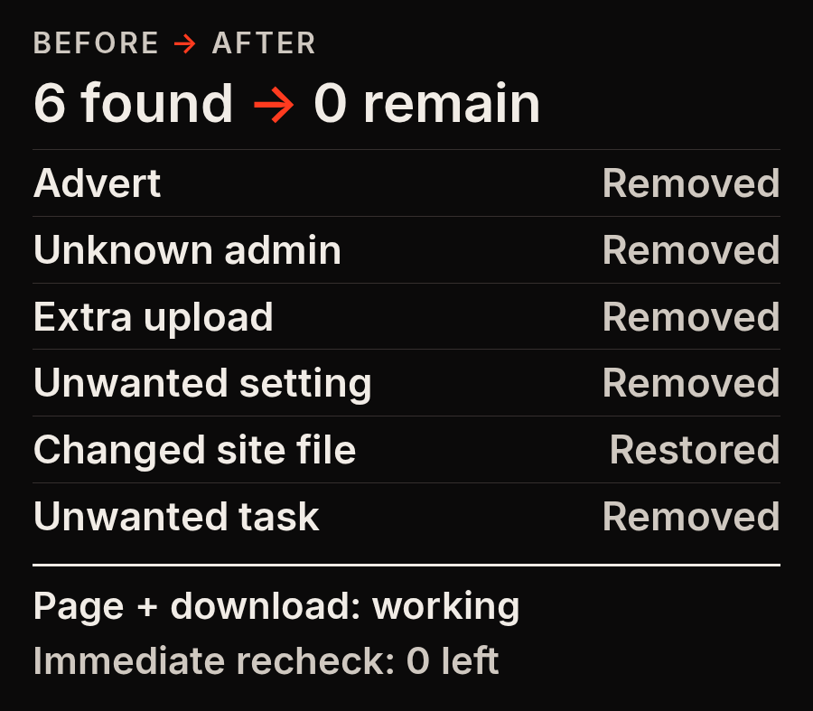
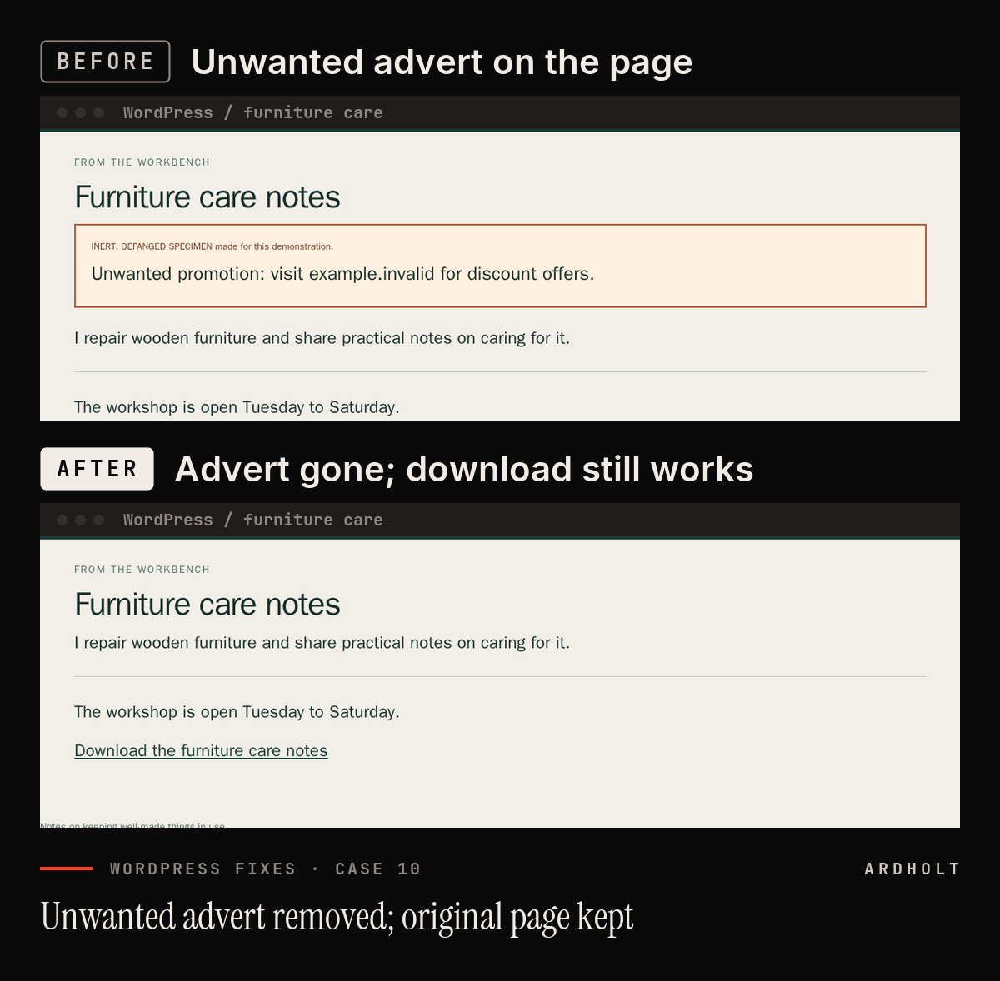

# My site was hacked

<p align="center">
  <a href="proof/cleanup-report.md"></a>
</p>

**I removed the unwanted changes and kept the original page and download working.**

<sub>Case 10 of 10 in [WordPress Fixes](../README.md)</sub>

## What was wrong

- An unwanted advert interrupted the page visitors came to read.
- Behind the page, I found an unfamiliar administrator, an extra upload, an unwanted setting and scheduled task, and a changed WordPress file.
- I carried out this cleanup on an isolated WordPress installation with harmless, labelled changes. This was not a customer's site.

## What I did

- I saved a private backup and checked which content, accounts and files belonged on the site.
- I removed the unwanted changes and restored the altered file from a verified copy, keeping the original page and download.
- I replaced the owner's password, ended old sign-ins and blocked unused ways to change or access the site.
- I checked the page and download in a browser, compared the WordPress files with their official copies, and repeated the checks after cleanup.

## Proof

[Read the six checks and their evidence](proof/cleanup-report.md). The picture below shows the page before and after; the record above also covers the changes visitors could not see.

<p align="center"></p>

| Check | Before | After |
|---|---|---|
| Unwanted changes | [6 found](proof/before.json) | [0 left](proof/after.json) |
| Page and download | [Present](proof/browser-before.json) | [Working](proof/browser-after.json) |
| WordPress files | [Altered](proof/core-before.txt) | [Match](proof/core-after.txt) |
| Immediate recheck | — | [0 left](proof/repeat.json) |

**Files:** [before screenshot](proof/before-mobile.png) · [after screenshot](proof/after-mobile.png) · [before records](proof/before.json) · [after records](proof/after.json) · [complete run](proof/run-output.txt)

The repeat check found none of these changes remaining. It ran immediately after cleanup; it is not a claim of weeks without reinfection. For a live business site, I would also trace how access was gained and arrange follow-up monitoring: [the recovery steps and limits](OPERATIONS.md#what-a-live-site-recovery-also-needs).

[Antivirus report](proof/scanner.txt) · [Repeat scan](proof/scanner-repeat.txt) · [Why the specimens cannot run](SAFETY.md) · [Sources for the claims](proof/claims.json)

## Try it yourself

```bash
./run.sh
```

The run reproduces the altered site, applies the cleanup and checks the result. It saves screenshots and reports in `proof/`, then removes the installation and its private backup. Docker and Docker Compose are required. See [commands and dependencies](OPERATIONS.md#reproduce-and-inspect).

## How it is tested

[Automated checks](https://github.com/Ardholt/wordpress-fixes/actions/workflows/hacked-site-cleanup.yml) · [Read the complete run](proof/run-output.txt)

- The checks reject the altered site, then pass after cleanup and on an immediate repeat.
- The original page, download, owner access and legitimate scheduled task must still work.
- The old password and sign-in session must stop working; file protections and the WordPress file comparison must pass.
- An independent antivirus scan covers the entire case folder and is repeated.

---

Fixed price in a written scope, sent within hours: see https://ardholt.com/p/prices/.

<sub>Maintained by Genco Doganay, Ardholt · [All 10 cases](../README.md) · [MIT licence](../LICENSE)</sub>
