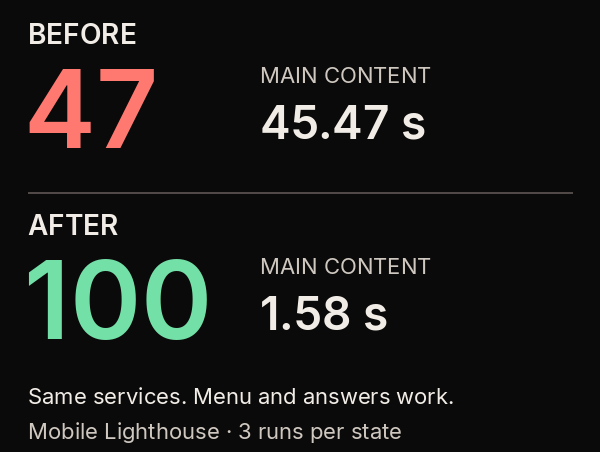

# Mobile PageSpeed in the 30s–40s

<p align="center">
  <a href="https://ardholt.github.io/wordpress-fixes/speed-mobile-score/proof/"></a>
</p>

**I brought the main content into view in [1.58 seconds instead of 45.47](proof/summary.json), keeping the page and its working controls.**

[See the page and readable results](https://ardholt.github.io/wordpress-fixes/speed-mobile-score/proof/) · [Watch the menu and answers work](media/page-in-use.gif)

<sub>Case 03 of 10 in [WordPress fixes](../README.md)</sub>

## What was wrong

- Large image uploads made the main picture arrive late on a phone.
- The theme waited for every image before showing it, then pushed the page down.
- Unused theme files loaded before visitors could see the page properly.

## What I did

- I served the same artwork in smaller sizes suited to each screen.
- I made the main image available immediately and reserved its space.
- I removed unused framework files, deferred navigation code and enabled asset caching.
- I checked every service, image, menu link and expandable answer after the change.

## Proof

I built and fixed this WordPress service page. I measured it with the same mobile Lighthouse settings and a fresh browser cache on every run. The figures below are medians of three runs per state.

| Measure | Before | After |
|---|---|---|
| Mobile score | [47](proof/summary.json) | [100](proof/summary.json) |
| Main content / LCP | [45.47 s](proof/summary.json) | [1.58 s](proof/summary.json) |
| Layout shift / CLS | [0.3195](proof/summary.json) | [0.0000](proof/summary.json) |
| Transferred resources | [8.59 MB](proof/summary.json) | [0.65 MB](proof/summary.json) |

Ranges, before → after: score **46–47 → 99–100**; LCP **45.42–45.49 s → 1.57–1.59 s**; CLS **0.3195–0.3195 → 0.0000–0.0000**.

**Does this match your site?** These fixes fit pages where oversized uploads, delayed main images or theme/plugin files slow the first view. I check the actual page and its essential features before choosing the changes. A different theme, host or set of plugins needs its own before-and-after measurement; this result is not a promised score for another site.

[Readable results and the retained page](https://ardholt.github.io/wordpress-fixes/speed-mobile-score/proof/) · [Every original HTML/JSON report](https://ardholt.github.io/wordpress-fixes/speed-mobile-score/proof/#reports) · [Measurement conditions](REPRODUCE.md) · [Source of each claim](proof/claims.json)

## Try it yourself

[Open the before Lighthouse report](https://ardholt.github.io/wordpress-fixes/speed-mobile-score/proof/before/run-2.report.html) · [Open the after Lighthouse report](https://ardholt.github.io/wordpress-fixes/speed-mobile-score/proof/after/run-2.report.html) · [Before raw JSON](proof/before/run-2.report.json) · [After raw JSON](proof/after/run-2.report.json)

[Open the full page capture](proof/after-mobile.png) and [watch the menu and answers](media/page-in-use.gif). No installation is needed to inspect these files.

### Run the WordPress page and checks locally

With Docker installed:

```bash
cd speed-mobile-score && ./run.sh
```

This starts WordPress, measures both states and saves the reports, then removes the stack. [Open either state in your browser and reset it](REPRODUCE.md).


## How it is tested

[Automated checks](https://github.com/Ardholt/wordpress-fixes/actions/workflows/speed-mobile-score.yml) · [Latest saved run](proof/run-output.txt)

- The same performance and resource checks fail before the fix and pass afterward.
- I compare every run for score, main-content timing, layout stability and transferred bytes.
- I open the menu and answers, follow the service link and check every image loads.
- The visible copy and image descriptions must match between states.

---

Fixed price for this kind of job: £75 (Site speed, £75, 3 working days), see https://ardholt.com/p/prices/.

<sub>Maintained by Genco Doganay, Ardholt · [All 10 cases](../README.md) · [Licence](../LICENSE)</sub>
