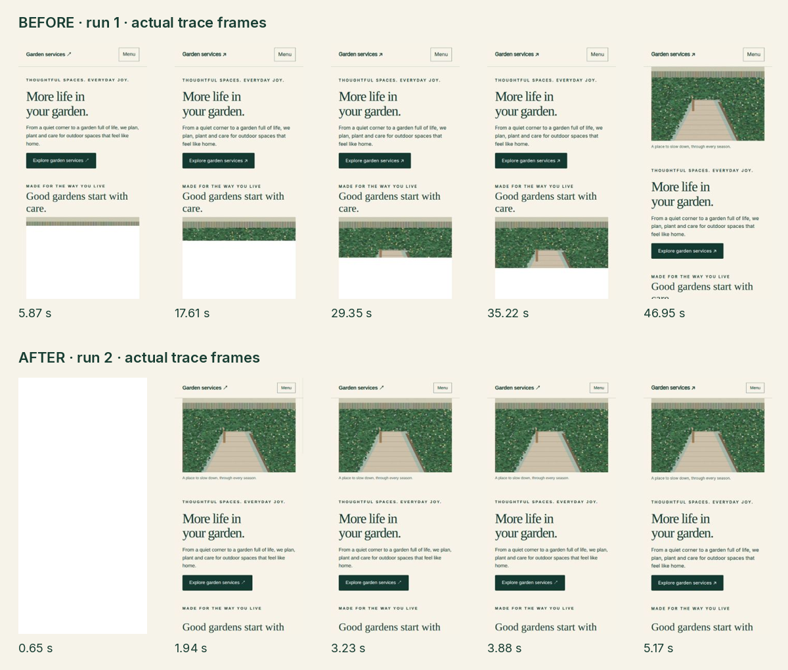

# The page is faster. The services still work.

**Mobile score 47 → 100. Main content 45.47 → 1.58 seconds.** I measured the same WordPress page before and after the fix.

[Open the full page capture](after-mobile.png) · [Watch the working controls](../media/page-in-use.gif)

The animation shows the real browser checks after loading: the menu opens, the services remain and an answer expands. It is not a loading-time recording. [Interaction record](interaction.json).

## Readable measurements

These are local mobile Lighthouse results. Each value is the median of three cold browser loads; every individual run is listed below. MB means 1,000,000 bytes.

| Measure | Before | After |
|---|---|---|
| Mobile performance | 47 | 100 |
| Largest contentful paint | 45.47 s | 1.58 s |
| Cumulative layout shift | 0.3195 | 0.0000 |
| Transferred resources | 8.59 MB | 0.65 MB |

Score ranges: **46–47 → 99–100**. LCP ranges: **45.42–45.49 s → 1.57–1.59 s**. CLS ranges: **0.3195–0.3195 → 0.0000–0.0000**.

## Every report

- **before, run 1:** score 47; LCP 45.49 s; CLS 0.3195. [HTML](before/run-1.report.html) · [JSON](before/run-1.report.json).
- **before, run 2:** score 47; LCP 45.47 s; CLS 0.3195. [HTML](before/run-2.report.html) · [JSON](before/run-2.report.json).
- **before, run 3:** score 46; LCP 45.42 s; CLS 0.3195. [HTML](before/run-3.report.html) · [JSON](before/run-3.report.json).
- **after, run 1:** score 99; LCP 1.59 s; CLS 0.0000. [HTML](after/run-1.report.html) · [JSON](after/run-1.report.json).
- **after, run 2:** score 100; LCP 1.58 s; CLS 0.0000. [HTML](after/run-2.report.html) · [JSON](after/run-2.report.json).
- **after, run 3:** score 100; LCP 1.57 s; CLS 0.0000. [HTML](after/run-3.report.html) · [JSON](after/run-3.report.json).

[Exact values and settings](summary.json) · [Measurement method](../REPRODUCE.md) · [Before checks](before-behavior.json) · [After checks](after-behavior.json) · [Execution log](run-output.txt)

## Loading sequence

[Frame selection and timestamps](visuals.json). The complete filmstrip remains in each raw report.

## Measurement records

[Configuration series](calibration/README.md) · [Repeatability records](verification/README.md). These separate series are not pooled with the comparison above.
