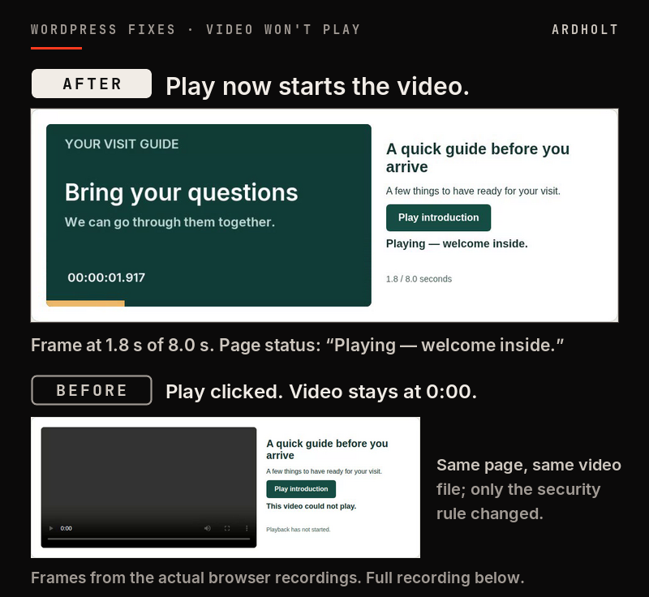
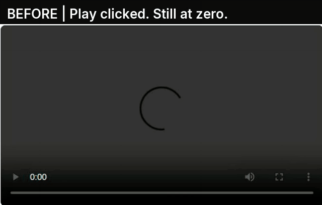
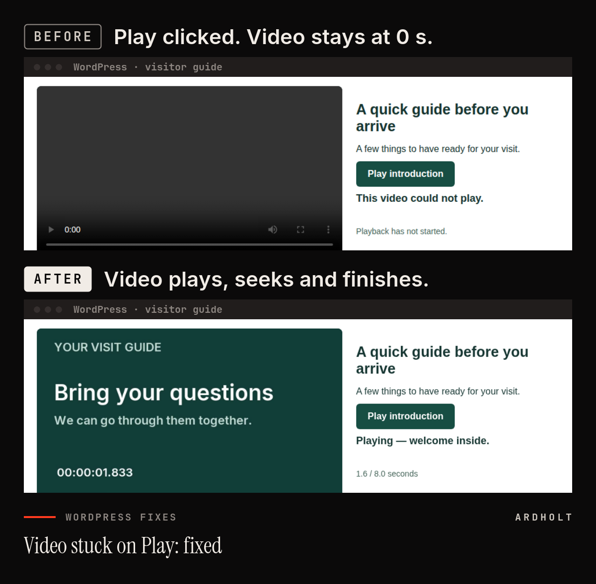

# Video will not play

<p align="center">
  
</p>

**I restored playback of a video hosted on WordPress.**

YouTube and Vimeo embeds need a separate diagnosis.

The picture above uses two frames from the actual browser recordings: the repaired video playing, and the failed attempt before the fix. The recording below loops the actual failed Play attempt, then playback after my fix. I made the short visitor-guide video; the same file is used before and after. [Open the recording file](media/playback.webm) to watch separately.

<p align="center">
  
</p>

## What was wrong

- The page loaded, but pressing Play left the video stuck.
- Visitors could read the introduction but could not watch it.
- A security rule was blocking the site's own video.

## What I did

- I reproduced the failed Play attempt and checked the browser's error.
- I changed the rule to allow video from this same website.
- I kept the other security rules in place.
- I checked that the video played, could skip ahead and reached the end, on desktop and at phone width.

## Proof

| Check | Before | After |
|---|---|---|
| Playback | [Stuck at 0 s](proof/before.json) | [Finished at 8 s](proof/after.json) |
| Seeking | [Media blocked](proof/before.json) | [Seek to 5 s passed](proof/after.json) |
| Other security rules | [Present](proof/before.json) | [Unchanged](proof/after.json) |

The close-up joins excerpts from the actual browser recordings. [Editing details](proof/edit.json) identify the crops and cuts; the complete page recordings remain available below.

<p align="center"></p>

**Full recordings:** [before](proof/before.webm) · [after](proof/after.webm). **Screenshots:** [before](proof/before.png) · [after](proof/after.png).

[Saved test results](proof/run-output.txt) · [what each claim is based on](proof/claims.json) · [video ownership and licences](ASSETS.md).

## Try it yourself

Watch the looping recording above, or open the full recordings to inspect the page before and after the repair.

### Reproduce the repair locally — technical instructions

From this folder, with Docker and Docker Compose installed:

```bash
./run.sh
```

This recreates the blocked page, records the failure, applies the repair and checks playback. It saves fresh proof and removes its containers when finished. The [reproduction guide](REPRODUCE.md) includes the exact header change, individual stages and reset commands. [Playground's limitation](proof/demo.json) is documented separately.


## How it is tested

[Automated checks](https://github.com/Ardholt/wordpress-fixes/actions/workflows/video-embed-wont-play.yml) · [saved run](proof/run-output.txt)

- I check that the browser blocks the video before repair and that a playback check fails on that page.
- After repair, I check moving video frames, a successful skip ahead and completion.
- I compare the security rules and check that the visit link and expandable information still work.

---

Fixed price for this kind of job: £10 (WordPress fix, £10 a fault, 1 working day), see https://ardholt.com/p/prices/.

<sub>Maintained by Genco Doganay, Ardholt · [WordPress Fixes](../README.md) · [MIT licence](../LICENSE)</sub>
